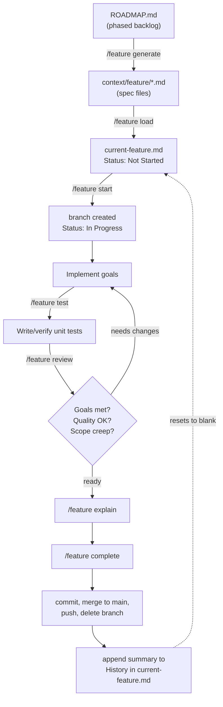
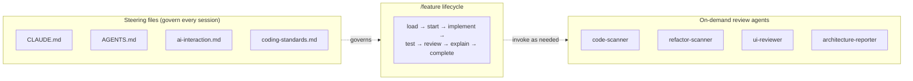

# ai-workflow

A portable `.claude/` + `context/` starter kit for running a spec-driven feature
workflow with [Claude Code](https://claude.com/claude-code). Extracted from real use
building [GamesCollection](../gamescollection-ai) rather than designed up front — the
`context/current-feature.md` history in that project is the actual evidence behind the
"what worked" / "what could be improved" notes below.

The idea: stop rebuilding the same agents, skill, and steering files for every new
project. Copy this folder in, fill in the placeholders, go.

## What this is

- **4 review agents** (`.claude/agents/`) — on-demand specialists for code quality,
  duplication, UI review, and architecture documentation.
- **A `/feature` skill** (`.claude/skills/feature/`) — manages a feature's full
  lifecycle from spec to merge, via `context/current-feature.md` as its working file.
- **Steering files** (`CLAUDE.md`, `AGENTS.md`, `context/ai-interaction.md`,
  `context/coding-standards.md`) — the rules Claude follows on every session:
  communication style, branching/commit discipline, code conventions.
- **A spec workflow** (`context/ROADMAP.md` → `context/SPEC_TEMPLATE.md` →
  `context/feature/*.md`) — write specs before code, so Claude implements against a
  written spec instead of a chat message.

None of this is framework-specific. The agents and skill are generic; only
`CLAUDE.md`, `coding-standards.md`, and `ROADMAP.md` need real project content.

## Quick start

1. Copy `.claude/`, `context/`, `CLAUDE.md`, `AGENTS.md`, and `.mcp.json` into your
   new project's root.
2. Fill in `CLAUDE.md` — project name, commands, real stack, DB info if any.
3. Fill in `context/project-overview.md` (a PRD: goals, non-goals, scope) and
   `context/coding-standards.md` (real conventions, not the bracketed prompts).
4. Write `context/ROADMAP.md` as a phased task breakdown for the actual project.
5. Run `/feature generate <phase>` to draft specs for a phase into `context/feature/`,
   or write one by hand from `SPEC_TEMPLATE.md`.
6. Run `/feature load <spec-name>` to load a spec into `context/current-feature.md`,
   then `/feature start` to begin.

## How the workflow fits together

The 4 agents sit outside this loop — invoked manually, whenever a review/report is
actually wanted, not on every feature:

## Components reference

### Agents (`.claude/agents/`)

| Agent | Purpose | Tools |
|---|---|---|
| `code-scanner` | Scans for security, performance, and code-quality issues; groups findings by severity | Read, Glob, Grep |
| `refactor-scanner` | Finds duplicated logic and suggests concrete utility-function extractions (DRY audit) | Glob, Grep, Read, IDE diagnostics |
| `ui-reviewer` | Drives Playwright to check layout, responsiveness, and accessibility across breakpoints | Read, Glob, Grep, Playwright MCP |
| `architecture-reporter` | Documents *why* the codebase is built the way it is, with evidence and trade-offs — for onboarding or interview prep | Read, Grep, Glob, Bash, Write |

### `/feature` actions (`.claude/skills/feature/actions/`)

| Action | What it does |
|---|---|
| `load` | Loads a spec (or inline description) into `current-feature.md`, sets Status to Not Started |
| `start` | Creates/checks out the feature branch, sets Status to In Progress, lists goals |
| `test` | Writes unit tests for new server actions/utilities that don't have them yet |
| `review` | Checks goals met, code quality, and scope creep; gives a ready/needs-changes verdict |
| `explain` | Summarizes what changed and why, file by file, for the current diff against main |
| `complete` | Commits, merges to main, resets `current-feature.md`, appends to History, pushes once |
| `generate` | Drafts spec files from a `ROADMAP.md` phase, using `SPEC_TEMPLATE.md` |

### Context files (`context/`)

| File | Role |
|---|---|
| `current-feature.md` | The single working file for whatever feature is active right now, plus an append-only History log of everything completed |
| `ai-interaction.md` | Communication style, the numbered feature workflow, branching/commit rules, "when stuck" guidance |
| `coding-standards.md` | Real per-project conventions (naming, error handling, file layout, etc.) |
| `project-overview.md` | A lightweight PRD — goals, non-goals, scope, success criteria |
| `ROADMAP.md` | Phased backlog; each item becomes a spec file |
| `SPEC_TEMPLATE.md` | The format every spec in `context/feature/` follows |

## What worked well

Drawn from actually running this on GamesCollection, not general praise:

- **Live verification over static reads.** Checking changes against a real running
  dev server (via Playwright, including computed-style checks) caught bugs a code
  read alone wouldn't have — e.g. a Tailwind v4 token defined through a second
  `var()` indirection that silently failed to generate its utility class, rendering
  a background fully transparent.
- **Explicit confirm-before-commit.** `ai-interaction.md`'s "never auto-commit" rule
  meant nothing landed on `main` without a deliberate look first — cheap insurance
  against an agent's confident-but-wrong judgment call.
- **The append-only History log is a real audit trail.** Every entry in
  `current-feature.md`'s History records not just *what* changed but *why*
  (including explicitly-confirmed deviations from spec) — genuinely useful months
  later, unlike a commit log alone.
- **Spec review before code.** Loading a spec and reading it against reality caught
  an internal contradiction (conflicting cascade-delete behavior) before any code
  was written, instead of discovering it mid-implementation.
- **The scanning agents found real, fixable issues.** `code-scanner` surfaced
  actual duplication — a byte-identical `ActionResult<T>` + `requireAuth()` pattern
  copy-pasted across four Server Action files — that got consolidated into a shared
  helper.

## What could be improved

Also concrete, not hypothetical:

- **`current-feature.md` tracks exactly one feature at a time.** Parallel work
  needs manual care — there's no built-in support for two features in flight.
- **The 4 agents are manual, not wired in.** Nothing automatically runs
  `code-scanner` before a commit or `ui-reviewer` after a UI change — it depends on
  remembering to invoke them.
- **`ROADMAP.md` drifts.** Scope changes discovered mid-spec (e.g. a field getting
  cut) need to be manually synced back into the roadmap, and that sync doesn't
  always happen right away.
- **No `settings.json` permission tuning.** Every tool call in a fresh project hits
  default prompts — the `fewer-permission-prompts` Claude Code skill could close
  this gap but wasn't set up here.
- **No CI.** `lint`/`build`/`test` are run manually per `ai-interaction.md`'s
  workflow rather than gated automatically on push.

## Is this worth having as a public repo?

Honestly: the value here is process and documentation discipline, not shipped
code — a legitimate but unusual portfolio signal. It reads better framed as a
personal tooling repo ("here's how I work with Claude Code") than as a flagship
project. Worth having, worth being upfront about what it is.
