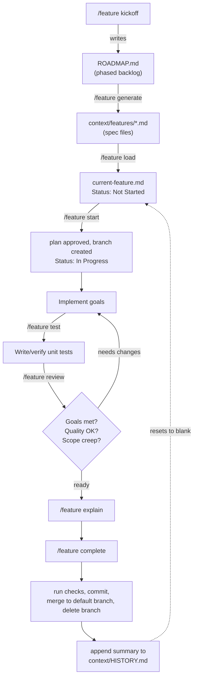
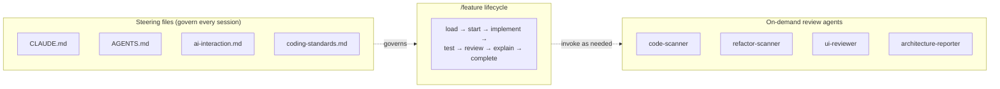

# ai-workflow

A portable `.claude/` + `context/` starter kit for running a spec-driven feature
workflow with [Claude Code](https://claude.com/claude-code). Extracted from real use
building [GamesCollection](../gamescollection-ai) rather than designed up front — the
`context/current-feature.md` history in that project is the actual evidence behind the
"what worked" / "what could be improved" notes below.

The idea: stop rebuilding the same agents, skill, and steering files for every new
project. Copy this folder in, fill in the placeholders, go.

## What this is

- **4 review agents** (`.claude/agents/`) — on-demand specialists for code quality,
  duplication, UI review, and architecture documentation.
- **A `/feature` skill** (`.claude/skills/feature/`) — manages a feature's full
  lifecycle from spec to merge, via `context/current-feature.md` as its working file.
- **Steering files** (`CLAUDE.md`, `AGENTS.md`, `context/ai-interaction.md`,
  `context/coding-standards.md`) — the rules Claude follows on every session:
  communication style, branching/commit discipline, code conventions.
- **A spec workflow** (`context/ROADMAP.md` → `context/SPEC_TEMPLATE.md` →
  `context/features/*.md`) — write specs before code, so Claude implements against a
  written spec instead of a chat message.
- **A kickoff step** (`/feature kickoff`) — turns an assignment into clarifying
  questions, a stack choice, a scaffolded project with working checks, and filled-in
  context files. `/feature kickoff lite` does the same for time-boxed work (interviews).

The skill and agents are written to be stack-agnostic; they read the stack and commands
from `CLAUDE.md`. Only `CLAUDE.md`, `coding-standards.md`, and `ROADMAP.md` (or
`SPEC.md` in lite mode) need real project content, and kickoff drafts those for you.

## Quick start

1. From your new project's root, run:

   ```bash
   curl -fsSL https://raw.githubusercontent.com/keff6/ai-workflow/master/install.py | python3 -
   ```

   It copies `.claude/`, `context/`, `CLAUDE.md`, `AGENTS.md`, and (optionally)
   `.mcp.json` into the current folder (or pass a path: `python3 - ~/projects/new-app`).
   It asks whether to use lite mode and whether to include the Playwright MCP server; skip
   the questions with `--lite`/`--no-lite` and `--playwright`/`--no-playwright`. Existing
   files are skipped unless you add `--force`; `--dry-run` previews, `--ref <tag>` pins a
   version.
   Or copy those files by hand.
   It can be an empty folder — kickoff will scaffold the project.
2. Run `/feature kickoff <assignment text or file>`. Answer its questions, approve the
   stack and slices; it scaffolds with the official generator, makes sure
   dev/build/lint/typecheck/test work, and fills in `CLAUDE.md`,
   `context/project-overview.md`, `context/coding-standards.md` and `context/ROADMAP.md`.
3. Run `/feature generate <phase>` to draft specs for a phase into `context/features/`,
   or write one by hand from `SPEC_TEMPLATE.md`.
4. Run `/feature load <spec-name>` to load a spec into `context/current-feature.md`,
   then `/feature start` to get a plan and begin.

## Interview / time-boxed mode

For a live coding test or a short take-home, the full PRD → ROADMAP → specs → branch per
feature pipeline costs more time than it saves. Use lite mode instead:

1. `/feature kickoff lite <assignment>` — restates the problem, asks at most 5
   questions (with default assumptions), proposes 3–6 vertical slices sized to the time
   box, scaffolds, verifies the checks, and writes a single `context/SPEC.md`.
2. Per slice: `/feature load slice 1` → `/feature start` → `/feature review` →
   `/feature complete`. No branches; one commit per slice on the current branch.
3. At the end: `/feature explain` for a walkthrough of the code, and the
   `architecture-reporter` agent for interview talking points and likely questions. The
   SPEC.md Decisions log becomes your README's "Decisions and trade-offs" section.

Practice it once before the real interview, and be ready to do it by hand if you can't
bring this kit.

## How the workflow fits together



The 4 agents sit outside this loop — invoked manually, whenever a review/report is
actually wanted, not on every feature:



## Components reference

### Agents (`.claude/agents/`)

| Agent | Purpose | Tools |
|---|---|---|
| `code-scanner` | Scans for security, performance, and code-quality issues; groups findings by severity | Read, Glob, Grep |
| `refactor-scanner` | Finds duplicated logic and suggests concrete utility-function extractions (DRY audit) | Glob, Grep, Read, IDE diagnostics |
| `ui-reviewer` | Drives Playwright to check layout, responsiveness, and accessibility across breakpoints | Read, Glob, Grep, Playwright MCP |
| `architecture-reporter` | Documents *why* the codebase is built the way it is, with evidence and trade-offs — for onboarding or interview prep | Read, Grep, Glob, Bash, Write |

### `/feature` actions (`.claude/skills/feature/actions/`)

| Action | What it does |
|---|---|
| `kickoff` | Assignment → questions → stack and slices → scaffold → working checks → context files. `kickoff lite` for time-boxed work |
| `generate` | Drafts spec files from a `ROADMAP.md` phase, using `SPEC_TEMPLATE.md`, and keeps the roadmap in sync |
| `load` | Loads a spec, a lite slice, or an inline description into `current-feature.md`; flags spec contradictions |
| `start` | Proposes a plan and waits; then branches (full mode) and implements, checking after each goal |
| `test` | Writes unit tests for the feature's logic with the project's test runner |
| `review` | Re-runs checks; checks goals met, code quality, and scope creep; gives a ready/needs-changes verdict |
| `explain` | Summarizes what changed and why, file by file |
| `complete` | Runs checks, stages by name, asks before committing; merges and logs to `HISTORY.md` (full) or ticks the slice (lite) |

### Context files (`context/`)

| File | Role |
|---|---|
| `current-feature.md` | The single working file for whatever feature is active right now. Kept small, since it loads every session |
| `HISTORY.md` | Append-only log of completed features and why. Not auto-loaded |
| `SPEC.md` | Lite mode only, created by `kickoff lite`: goal, assumptions, acceptance criteria, slices, decisions log |
| `ai-interaction.md` | Communication style, the numbered feature workflow, branching/commit rules, "when stuck" guidance |
| `coding-standards.md` | Real per-project conventions (naming, error handling, file layout, etc.) |
| `project-overview.md` | A lightweight PRD — goals, non-goals, scope, success criteria |
| `ROADMAP.md` | Phased backlog; each item becomes a spec file |
| `SPEC_TEMPLATE.md` | The format every spec in `context/features/` follows |

## What worked well

Drawn from actually running this on GamesCollection, not general praise:

- **Live verification over static reads.** Checking changes against a real running
  dev server (via Playwright, including computed-style checks) caught bugs a code
  read alone wouldn't have — e.g. a Tailwind v4 token defined through a second
  `var()` indirection that silently failed to generate its utility class, rendering
  a background fully transparent.
- **Explicit confirm-before-commit.** `ai-interaction.md`'s "never auto-commit" rule
  meant nothing landed on `main` without a deliberate look first — cheap insurance
  against an agent's confident-but-wrong judgment call.
- **The append-only History log is a real audit trail.** Every entry in the
  History log (now `context/HISTORY.md`) records not just *what* changed but *why*
  (including explicitly-confirmed deviations from spec) — genuinely useful months
  later, unlike a commit log alone.
- **Spec review before code.** Loading a spec and reading it against reality caught
  an internal contradiction (conflicting cascade-delete behavior) before any code
  was written, instead of discovering it mid-implementation.
- **The scanning agents found real, fixable issues.** `code-scanner` surfaced
  actual duplication — a byte-identical `ActionResult<T>` + `requireAuth()` pattern
  copy-pasted across four Server Action files — that got consolidated into a shared
  helper.

## What could be improved

Also concrete, not hypothetical:

- **`current-feature.md` tracks exactly one feature at a time.** Parallel work
  needs manual care — there's no built-in support for two features in flight.
- **The 4 agents are manual, not wired in.** Nothing automatically runs
  `code-scanner` before a commit or `ui-reviewer` after a UI change — it depends on
  remembering to invoke them.
- **`ROADMAP.md` drifts.** Scope changes discovered mid-spec (e.g. a field getting
  cut) need to be synced back into the roadmap. `/feature generate` now updates it
  when writing specs changes scope, but changes found later, during implementation,
  still need a manual sync.
- **No `settings.json` permission tuning.** Every tool call in a fresh project hits
  default prompts — the `fewer-permission-prompts` Claude Code skill could close
  this gap but wasn't set up here.
- **No CI or hooks.** `/feature start`, `review` and `complete` now run the checks,
  but nothing gates a push automatically. A Claude Code hook that runs typecheck/lint
  after edits, plus a CI workflow, would close this.

